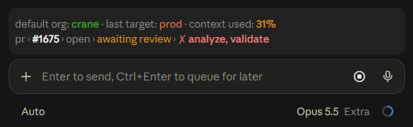

<div align="center">
	
	<h1>Salesforce Headless Band</h1>
</div>

<h4 align="center">
	<a href="#overview">Overview</a> |
	<a href="#setup">Setup</a> |
	<a href="#how-it-works">How it Works</a> |
	<a href="#faqs">FAQs</a> |
	<a href="#contributing">Contribute</a>
</h4>

<h3 align="center">
	Shows which Salesforce orgs Claude can reach, right above the prompt<br><br>
</h3>

<div align="center">
	
</div>

<br>

## Overview

> **Disclaimer:** This is a community project and not an official Salesforce product. It is not supported, endorsed, or maintained by Salesforce.

A [Claude Code mod](https://code.claude.com/docs/en/plugins/mods/overview) that shows, above the prompt, the Salesforce org your CLI commands will reach, the org your last `sf` command actually reached when that was a different one, how full Claude's context window is, and the pull request for the branch you're on. It also shows the Salesforce MCP servers you have added to Claude Code, so you can see every org Claude can reach.

This is a fork of [deejay-hub/sf-headless-band](https://github.com/deejay-hub/sf-headless-band) by Dave Norris. The original shows each org's type on a colored pill. This fork labels the CLI line in words, colors the org's name instead of adding a pill, and adds the last target, the context figure, and the PR line. The MCP lines are the original's.

| Line | Shows |
|------|-------|
| `default org:` | The Salesforce CLI's default org, colored by type, with its My Domain, a login that isn't yours, a project-set default, and a scratch org's days to expiry where each applies; then the org your last `sf` command reached, and how full the context window is |
| `pr ›` | The pull request for the folder's branch, or the one this session last worked on: its state, review, gates, checks, and conflicts |
| `sf › mcp` (DX) | Each [Salesforce DX MCP Server](https://developer.salesforce.com/docs/atlas.en-us.sfdx_dev.meta/sfdx_dev/sfdx_dev_mcp.htm) and the orgs its `--orgs` flag allows |
| `sf › mcp` (hosted) | [Salesforce Hosted MCP servers](https://developer.salesforce.com/docs/atlas.en-us.api_meta.meta/api_meta/meta_mcp_server_eca.htm), grouped by the org they reach |

## Setup

#### Requirements

* Claude Code v2.1.287 or later, in the terminal or the Code tab of the Claude Desktop app
* The Salesforce CLI with at least one authorized org, or a Salesforce MCP server (DX or hosted) added to Claude Code
* For the PR line, `git` and the GitHub CLI (`gh`), signed in

#### Install

At the prompt of a terminal session:

```text
/plugin install sf-headless-band --marketplace rob-alexa/sf-headless-band
```

From a shell:

```bash
claude plugin install sf-headless-band --marketplace rob-alexa/sf-headless-band
```

In the desktop app, where `/plugin` does not run: click + next to the prompt box, then Plugins, Add marketplace with `rob-alexa/sf-headless-band`, then Add plugin.

#### Try it from a clone

1. Clone this repository:
   ```bash
   git clone https://github.com/rob-alexa/sf-headless-band.git
   ```

2. Launch Claude Code in your Salesforce project with the mod loaded:
   ```bash
   cd ~/projects/my-sfdx-project
   claude --plugin-dir ~/path/to/sf-headless-band
   ```

3. Type `/sf-headless-band` to show the band.

To load a clone in every session, add its folder to `CLAUDE_CODE_PLUGIN_DIRS` in the `env` block of `~/.claude/settings.json`, as an absolute path or one starting with `~`:

```json
{
  "env": {
    "CLAUDE_CODE_PLUGIN_DIRS": "~/path/to/sf-headless-band"
  }
}
```

#### Hide or show it

The band starts off. Type `/sf-headless-band` to show it, and again to hide it; `/sf-headless-band on` and `/sf-headless-band off` say which. The choice is kept across sessions. In a terminal, the `[-]` mark at the band's right edge only folds it for now.

#### Settings

Four optional settings, under `pluginConfigs` in `~/.claude/settings.json`:

```json
{
  "pluginConfigs": {
    "sf-headless-band": {
      "options": {
        "sharedSandboxes": ["acme--uat"],
        "sharedSandboxLabel": "shared QA sandbox",
        "gates": ["review-gate=awaiting review", "qa-gate=QA open"],
        "sfWrappers": ["sfw"]
      }
    }
  }
}
```

* `sharedSandboxes`: the My Domain names of sandboxes a whole team shares, the part of the URL before the first dot. Their names show in yellow on the CLI line, where your own sandboxes show in green.
* `sharedSandboxLabel`: the words on a shared sandbox's pill on an MCP line, in place of `sandbox`. Default `shared sandbox`.
* `gates`: commit statuses that stand for a person's step, each as `status=words`. The PR line shows the words while the status has not passed and leaves it out of the checks' counts. This helps where a repo requires no approvals, so GitHub's own review decision stays blank.
* `sfWrappers`: commands that wrap the Salesforce CLI, by name. The last target reads their `-o` and `--target-org` as it does for `sf`.

## How it Works

### The CLI line

```text
default org: my-scratch › speedy-1-dev-ed › expires in 2 days · last target: prod · context used: 16%
```

The CLI line shows wherever a default org is set: the project's, else your global one, as a DX server's `DEFAULT_TARGET_ORG` resolves it. After `default org:` comes the org's alias, bold, in its color: orange for production, yellow for a shared sandbox, green for any other sandbox or a scratch org, blue for a developer edition, and gray when the type is unknown. Then come these, each only when it applies:

* **The My Domain**, unless it only repeats the alias (`acme--dev` for `dev`).
* **`as <name>@`**, in yellow, when the org's login is neither your Claude account's email nor a sandbox copy of it (`you@acme.com.dev`).
* **`local config`**, in yellow, when the project's own `.sf/config.json` or `.sfdx/sfdx-config.json` sets the org over your global default.
* **A scratch org's days to expiry**, in red from three days out.

When an MCP line shows too, the CLI line starts with `sf › cli ›` to tell the two apart.

### Last target

`· last target:` names the org the session's last `sf` command reached when that was not the default org, riskiest first when it reached several. It reads the command's text:

* `-o`, `--target-org`, or `-u` on an `sf` or `sfdx` command, or on a wrapper named in the `sfWrappers` setting
* `SF_TARGET_ORG` or `SFDX_DEFAULTUSERNAME` set in the command, as a prefix, an `export`, or PowerShell's `$env:`
* `--target-org` or `--org` on a `.sh` script

Bash and PowerShell commands both count, and so does one that failed or that you declined at a prompt, since you can't always tell whether it ran. A command a `PreToolUse` hook refused does not count. Text in quotes, in a heredoc, or in a commit message is not read as a command. A later `sf` command on the default org clears the marker, and one that reaches no org, such as `sf config` or `git`, leaves it. After a resume, it is read back from the transcript.

### Context used

`· context used:` is how full Claude's context window is: green below 30%, yellow from 30%, and orange from 40%. It shows once a response has reported it, and only on the CLI line, so a folder with no default org shows no figure.

### The PR line

```text
pr › #42 › open › awaiting review › QA open › ✗ validate
```

The PR line shows the pull request for the session folder's branch. When that branch has none, it shows the newest one a command in this session created or acted on, so a session working on another folder's branch still sees its own. In order, it shows:

* The number, then `open`, `draft`, `merged`, or `closed`.
* For an open one, `approved` or `changes requested`, the words for each gate not yet passed (see **Settings**), the failing checks (two by name, then a count), or else how many checks are still running, or `checks ✓`, and `conflicts`.

It reads the pull request with `gh pr view` when the session starts or changes folder, at once after a command creates one, at the end of a turn when the branch changed or the last answer is more than two minutes old, and every two minutes while it is open or a draft. Without `git` or a signed-in `gh`, or outside a git repository, there is no PR line.

### Salesforce DX MCP Server

The [Salesforce DX MCP Server](https://developer.salesforce.com/docs/atlas.en-us.sfdx_dev.meta/sfdx_dev/sfdx_dev_mcp.htm) (`@salesforce/mcp`) uses the CLI's auth files. Its `--orgs` flag lists the only orgs it may reach. Each DX MCP server gets a line listing those orgs by alias, with their types:

```text
sf › cli › default org: my-scratch › speedy-1-dev-ed › expires in 2 days
sf › mcp › ✓ salesforce-dx › my-scratch, uat › speedy-1-dev-ed, acme--uat › [ scratch ] [ sandbox ]
```

`DEFAULT_TARGET_ORG` and `DEFAULT_TARGET_DEV_HUB` show as the alias they resolve to. `ALLOW_ALL_ORGS` adds an **all orgs** pill in production red, because it can reach production. Each org the server reaches gets its own pill.

To keep MCP on the same org as the CLI, start the server with `--orgs DEFAULT_TARGET_ORG` and don't name orgs in your prompts. The `sf › mcp` line then names the same org as the `sf › cli` line.

### Salesforce Hosted MCP servers

[Hosted MCP servers](https://developer.salesforce.com/docs/atlas.en-us.api_meta.meta/api_meta/meta_mcp_server_eca.htm) are the ones you sign in to with OAuth through an External Client App. Each line lists server names and an org type:

```text
sf › mcp › ✓ metadata-experts, ✓ sobject-all › acme › [ production ]
sf › mcp › ✗ globex-sobjects › [ production ]
sf › mcp › ✗ sobject-all-uat › [ sandbox ]
```

The mod finds a hosted server by its URL, `https://api.salesforce.com/platform/mcp/<version>/[sandbox/]platform/<server>`. That holds for an `http` server and for an `mcp-remote` bridge that names the URL in its args. It reads the type from the URL: a `/sandbox/` path serves sandbox and scratch orgs, and any other path serves production.

Servers that share an External Client App's consumer key reach the same org, so they share a line. A different key means a different org and gets its own line, even when both orgs are production. Claude Code keeps the OAuth token in its own credential store, so the mod can't tell which org or user you signed in as. That's why these lines name servers, not orgs.

### The rules the org lines follow

* **Which servers are in use:** the copy of each server name Claude Code uses (local over project over user), from `.mcp.json` files in the folder upward, and not one you've disabled with `/mcp`.
* **Each org's type:** scratch and sandbox from the CLI auth file's flags, developer edition from a `-dev-ed` My Domain, otherwise production. A hosted server shows no type until one of its calls has carried its org's My Domain; then that names the org on its line and gives its type.
* **What a DX server reaches:** `DEFAULT_TARGET_ORG` and `DEFAULT_TARGET_DEV_HUB` resolved as the CLI does (`SF_TARGET_ORG` first, then the project's `sfdx-project.json` root, then your global config). The line takes the riskiest org's type, and `ALLOW_ALL_ORGS` counts as production.
* **The pill colors on the MCP lines:** red production, blue developer edition, yellow sandbox, green scratch, and gray unknown.
* **Connected or not:** `✓` once the session has a server's tools, `✗` until then.
* **Changes made elsewhere:** `sf config set target-org` in a terminal, an alias, or an MCP server changed in another session shows within about three seconds.

### Project Structure

```
sf-headless-band/
├── .claude-plugin/
│   ├── plugin.json              # The plugin manifest, with the four settings
│   └── marketplace.json         # Makes this repository a marketplace to install from
├── hooks/
│   ├── hooks.json               # Points Claude Code to register.tsx
│   ├── register.tsx             # Refreshes the org and the pull request, and draws the band
│   ├── org.ts                   # Finds the project, the default org, its type, and its expiry
│   ├── mcp.ts                   # Finds the Salesforce MCP servers in use for the folder
│   ├── salesforce.ts            # Salesforce rules, from sf-headless-config
│   ├── additions.ts             # The CLI line's labels and colors, and the settings
│   ├── targets.ts               # The orgs an sf command names, for the last target
│   └── pr.ts                    # The PR line, read with gh
├── types/
│   └── index.d.ts               # Declares the mod's $.state values
└── tests/                       # Tests for the lookups, the last target, the PR line, and the band
```

**`org.ts`** reads the Salesforce CLI's config, alias, and auth files to find the default org, its type, and its expiry, and whether the project's own config set it.

**`mcp.ts`** finds hosted servers and their type, and DX MCP servers and the orgs they allow.

**`salesforce.ts`** holds the rules for which servers are in use, the orgs they reach, org types, and colors.

**`additions.ts`**, **`targets.ts`**, and **`pr.ts`** hold this fork's additions, kept apart from the original's files so the two stay easy to compare.

## FAQs

#### Does the mod call Salesforce or the MCP servers?

No. It never runs `sf` and never calls the MCP servers. It reads files, and the PR line runs `git` and `gh`, which reach GitHub. Nothing else touches the network.

#### What does it read?

Salesforce CLI internals (`~/.sf/config.json`, `~/.sfdx/alias.json`, `~/.sfdx/<username>.json`, and the project's own `.sf/config.json` and `.sfdx/sfdx-config.json`). These are not a public API, so a future CLI release could change them. From the auth files it reads only the type, expiry, and instance URL fields.

For MCP it reads Claude Code's own MCP config: user and local scope in `~/.claude.json` (or `$CLAUDE_CONFIG_DIR/.claude.json`), and project scope in `.mcp.json` files from the folder upward. It reads only each server's `command`, `url`, `args`, and consumer key (`oauth.clientId`, or the `client_id` in mcp-remote's `--static-oauth-client-info`), never its `headers` or any secret.

It also reads your Claude account's email from `~/.claude.json`, to tell your own logins from other ones, and the text of the session's shell commands, to find the last target and the session's own pull request.

#### Why does a hosted server line name servers, not an org?

Claude Code keeps the OAuth token in its own credential store, so the mod can't tell which org or user you signed in as. Once one of the server's calls carries the org's My Domain, the line names the org and shows its type.

#### Where do the lines show?

The CLI line shows wherever a default org is set. The MCP lines show in any folder where a server is configured. Outside a project, `DEFAULT_TARGET_ORG` resolves to your global default. The PR line shows on any branch with a pull request, and once a command in the session has created or acted on one.

#### How does it relate to sf-headless-config?

sf-headless-config is the full pane for your Salesforce MCP servers: every scope, every copy, add, edit, and delete. This band is the short version, showing only what's in use for the folder. The original keeps `hooks/salesforce.ts` identical to sf-headless-config's copy so the two always agree. This fork adds to that file, to mark a default org the project sets, so the two copies no longer match exactly.

## Contributing

See [CONTRIBUTING.md](CONTRIBUTING.md). For changes to the original band, go to [deejay-hub/sf-headless-band](https://github.com/deejay-hub/sf-headless-band).

Check and test your changes before submitting:

```bash
claude plugin validate .
claude plugin test
```

## License

MIT. The original is copyright Dave Norris; see [LICENSE](LICENSE).
